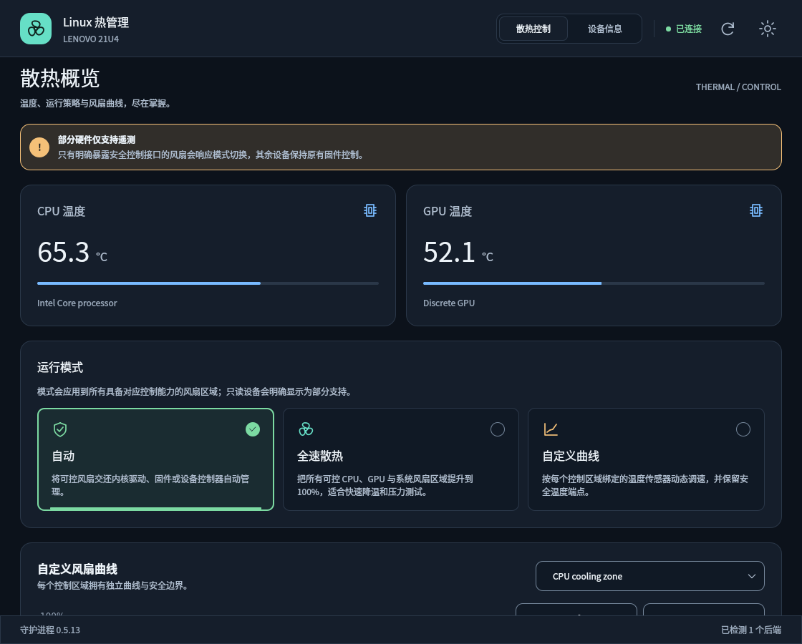

# 前端结构与视觉规范

## 模块边界

前端使用三个 CMake 目标，各自承担独立职责：

| 目标 | 入口/目录 | 职责 |
| --- | --- | --- |
| `linux-thermal-control` | `src/app/main.cpp`、`platform/` | Qt 启动、单实例、系统托盘与退出恢复 |
| `linux-thermal-client` / `LinuxThermal.Backend` | `src/app/client/`、`models/` | D-Bus 通信、设备与曲线模型、服务端状态 |
| `linux-thermal-ui` / `LinuxThermal.Control` | `src/app/qml/LinuxThermal/Control/` | 页面、交互状态、视觉规范、公共控件 |

客户端不依赖 Qt Quick 或 Widgets。可执行入口和测试程序分别链接 UI、客户端及其静态 QML 插件。两个模块输出到 `build/<配置>/qml/LinuxThermal/`，避免依赖可执行文件内部注册才能导入 UI。

```text
main.cpp ── platform/                  单实例、托盘
   │
   └── Main.qml                        组装窗口，注入 FanBackend
          ├── state/AppController.qml  页面选择、模式切换确认、错误反馈
          ├── state/AppSettings.qml    QSettings 外观偏好
          ├── Theme.qml                语义颜色、字号、间距、动效时长
          ├── pages/                   导航、页面组合
          ├── panels/                  业务区域与数据绑定
          ├── components/              无 D-Bus 依赖的公共控件
          └── dialogs/                 错误、外观弹窗

FanBackend ── InventoryModels ── 私有/系统 D-Bus ── daemon
```

只有 `Main.qml` 引用 `FanBackend` 单例；页面和状态控制器通过显式属性接收后端。新增控件不应自行发起 D-Bus 调用。`AppController` 仅管理界面状态，硬件能力判断、温度保护和写入权限由客户端及守护进程负责。

模式切换同时等待操作回包和对应的服务端模式；失败会结束切换状态，其他模式的过期回包不会结束当前操作。视觉过渡不会跳过服务端确认。

GUI 冒烟检查位于 `tests/app/GuiSmokeChecks.*`，仅在 `BUILD_TESTING=ON` 时加入应用。正常启动路径不包含测试调度逻辑。测试外观偏好写入临时目录。

## 审查与改造

目标为 Linux 桌面、矩形窗口、中文、桌面观看距离、键盘与鼠标。默认宽度 1120，窗口高度受可用桌面空间限制；最小窗口 760 × 620。

| 等级 | 原有问题 | 实施结果 |
| --- | --- | --- |
| 严重 | 自定义按钮缺少键盘焦点，浅色状态文字对比度不足 | 焦点边框、可访问名称、明暗语义色、状态文字与选中标记 |
| 警告 | 温度、模式和曲线缺少层级，三个纵向模式占据过多空间 | 页面标题、温度大读数、宽屏三列模式、窄屏堆叠 |
| 警告 | 字号散落在组件中，部分标签仅 10px | 集中字体角色，随系统字体放大；使用 12/16/28/38 四档 |
| 机会 | 动效较少，切换反馈不够明显 | 卡片错峰入场、悬停抬升、导航及模式滑动指示、选中回弹与曲线变化；按产品要求移除动画关闭开关 |
| 警告 | 默认输入框与自定义卡片风格不一致 | `ActionButton`、`SelectField`、`CurveSpinBox` |
| 机会 | 曲线缺少图例，控制点行过长 | 目标曲线填充、当前读数图例、独立 `CurvePointRow`，按钮自动换行 |
| 警告 | 部署扫描遗漏运行时使用的 Qt Controls 通用模块 | 非定制页面使用通用导入，定制控件保留 Basic；安装目录脱离 SDK 验证 |
| 结构 | 主窗口含状态机，入口含大量测试代码 | 状态控制器、独立客户端/UI 模块、测试目录与独立预览工具 |

温度条使用当前显示温度 / 100 的固定刻度；它不是温度历史，也不代表各设备的安全阈值。传感器不可用时清空刻度。曲线的安全端点、邻点限制与最低占空比沿用原有模型约束。

## 联网方案比较

| 方案 | 适用场景 | 本项目判断 |
| --- | --- | --- |
| Qt Quick Controls Basic + 语义主题 | 深度定制、控制依赖规模、兼容现有 QML | 本次采用，直接复用 Qt 6.11.2 |
| [KDE Kirigami](https://develop.kde.org/docs/getting-started/kirigami/) | Qt Quick Controls 2 上的自适应桌面/移动应用 | 如果未来需要更强的 KDE 桌面融合，可另行迁移评估 |
| [QML FluentUI](https://github.com/zhuzichu520/FluentUI) | 整套 Fluent 风格 QML 控件 | 可作为外观参考；整体迁移需另评估插件、打包与维护成本 |
| [Qt Lottie Animation](https://doc.qt.io/qt-6/qtlottieanimation-index.html) | 设计师提供的矢量动画资产 | 当前交互用原生 QML 即可；复杂插画动画再按其格式限制评估 |

以上迁移取舍是针对本项目的工程判断。布局参考 [Fluent 2 的间距与层级](https://fluent2.microsoft.design/layout)，动效参考 [Fluent 2 的功能性与缓动原则](https://fluent2.microsoft.design/motion)。没有复制这些系统的品牌资产。

- 按压与淡出：140ms；导航滑块与回弹：240–360ms；温度条变化：360ms；曲线展开：420ms。
- 顶部按钮通过共享底板滑动切换；模式按钮通过共享指示条滑动、选中背景淡入和勾选回弹切换，窄屏下自动纵向移动。
- 卡片进入滚动视口时错峰淡入并上移，悬停抬升；曲线初次展示逐段展开，修改控制点时平滑插值。
- 页面切换：140ms 退场 + 240ms 入场，方向与导航一致。
- 刷新旋转仅在真实刷新期间运行，全速模式图标仅在该模式启用且可见时旋转；窗口隐藏或卡片离开视口后停止。
- 动画主要作用于透明度与变换，不逐帧重排页面。
- 图标为可缩放 SVG，按主题着色；兼容软件渲染下的滚动裁剪。

目前没有 Figma 文件、设计令牌导出或 Figma MCP 连接。本次视觉规范来自现有项目与公开设计资料，没有声称生成或同步了 Figma 组件。

## 构建与验证

```bash
./scripts/build.sh
source docker/common.sh
run_dev ctest --test-dir /workspace/build/docker-debug --output-on-failure
run_dev cmake --build /workspace/build/docker-debug --target all_qmllint
```

`tests/qml/tst_AppController.qml` 覆盖模式确认的不同到达顺序、失败重试、无关回包、错误确认和曲线应用条件。`tst_AppearancePopup.qml` 验证键盘选择主题与 Escape 关闭。新增的动效检查覆盖导航滑块、横向/纵向模式指示条、连续切换、卡片入场、按钮悬停按压和曲线插值。完整 CTest 还包含页面导航、单实例、托盘、D-Bus 及后端安全测试。

生成真实 QML + D-Bus mock 服务的界面截图：

```bash
source docker/common.sh
run_dev /workspace/tests/integration/run-ui-preview.sh \
  /workspace/build/docker-debug/src/daemon/linux-thermal-daemon \
  /workspace/build/docker-debug/tests/linux-thermal-ui-preview \
  /workspace/build/docker-debug/ui-preview
```

此工具创建私有 D-Bus 会话并启动 `--mock` 守护进程，覆盖明暗主题、设备页、曲线底部、外观弹窗、760 × 620 窄窗和 140% 系统字体。截图使用模拟硬件读数，不访问宿主机风扇写接口。预览工具和测试的设置使用临时目录，不改变日常外观偏好。


## 本次验证结果与预览

- Ubuntu 22.04 / GCC 12 / Qt 6.11.2 Docker 构建通过，`BUILD_TESTING=OFF` 构建与启动参数检查通过。
- 完整 CTest：12/12 通过；其中 Qt Quick Test：32 项检查通过（含初始化、清理），无失败或跳过。
- `all_qmllint` 无警告；新增和修改的集成脚本通过 ShellCheck。
- 临时 `DESTDIR` 安装后，清除 SDK 的库、QML 和插件路径，使用包内启动器、Xvfb 与私有 mock 服务完成页面切换；无组件加载警告。
- 语义文字与卡片底色的对比度最低为 4.78:1；输入边框与卡片底色最低为 3.42:1。状态仍由文字和选中标记共同表达。
- 明暗主题、760 × 620 窗口、140% 字体和曲线操作区完成渲染检查。模拟硬件截图如下。

| 浅色 | 深色 | 设备页 | 曲线 |
| --- | --- | --- | --- |
| [查看](screenshots/light.png) | [查看](screenshots/dark.png) | [查看](screenshots/devices.png) | [查看](screenshots/curve.png) |

[外观设置](screenshots/appearance.png) · [窄窗口](screenshots/compact.png) · [大字体](screenshots/large-font.png)



Qt 6.11.2 的应用部署扫描可能缓存跨库 QML 的 import 清单。增加 import 后，应使用干净构建目录验证安装，避免增量构建沿用旧依赖清单。生成的扫描缓存位于构建目录，不属于源文件。


## 动态预览

[查看按钮切换与曲线动效演示](screenshots/motion.gif)。演示由真实 Qt 界面和私有 mock 服务录制，包含悬停、全速/曲线模式切换、曲线控制点修改以及页面往返。

录制帧序列（使用新的输出目录，避免混入旧帧）：

```bash
source docker/common.sh
run_dev /workspace/tests/integration/run-mock-dbus-test.sh \
  /workspace/build/docker-debug/src/daemon/linux-thermal-daemon \
  /workspace/build/docker-debug/tests/linux-thermal-ui-preview \
  --dark --motion-output /workspace/build/docker-debug/ui-motion
```

录制模式只允许在私有 mock D-Bus 会话中运行；普通截图不会切换模式或修改控制点。帧可以在宿主机使用 FFmpeg 合成为 GIF 或视频。
